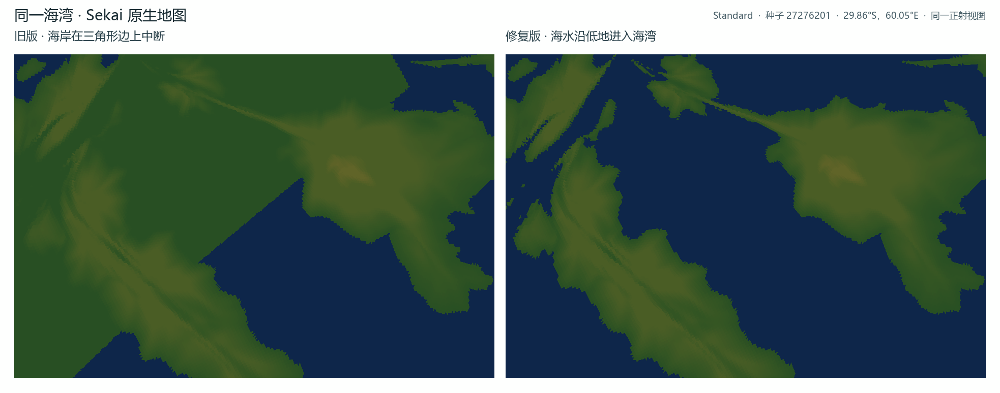

# 来源三角形直岸的复现与海岸连通修复

## 同一地形上的对照

本机原生 Release，种子 27276201、C2 Standard、默认 Atlas 作者参数，34,029 个来源格。
旧模型 4 在来源站点 11711 与 11869 的公共边上，有一段 55.5 km 的海陆翻转。南端位于
30.0370° S、59.8109° E，北端位于 29.7180° S、60.2532° E。旧版本的 183 对横向采样
全部重现，每对分居公共边两侧各 20 m，366 个床高全低于海平面。

直接用生产细床做两项独立检查：

- 原海岸中部到海洋来源站点 11868 的球面路径长 91.41 km。301 个采样点的最高床高为
  −143.64 m。此处预期两侧都属于海洋。
- 附近一处无海源洼地位于 28.42331° S、60.29940° E，床高 −40.01 m。半径 16 km 的
  环在约 305 m 间距下的最低床高为 +42.15 m，加密到约 19 m 后仍高于 +42 m。
  最近的来源站点距洼底 20.07 km。这里预期为干陆。

这两个预期由实际高程和来源站点独立确定。修改床高、给整块负地形灌水或清除所有直岸均不能
同时证明修复正确。真实世界及程序化地形本身产生的直岸可以保留。

## 工作尺度的选择

初版只沿共享边采样到原生细床像素尺度。虽然旧位置的 183 对不再翻转，全世界新产生的
56,261 条不同归属的支撑边中，按原生步长的四分之一检查仍有 629 条查到负床，十六分之一时
有 790 条。因而不能仅把粗三角形的二元标签换成更小的标签。

修订 R3 使用海源实际过水路径和封闭低地标记。对正高程地面用标记分水，分界再以原始细床
核查，遇到水下窗口就补充证据。床面、海平面和湖面均未为消除直线做修形。
沿海支撑从上游底图的一个二分父级开始，出现不同水下部分或发现新的水下入口时只加密
相应小三角形。工作尺度与限制见[规格 R3](../specs/2026-11-03-world-truth-scope-design.md)。

## 原生界面与精确床面对照

上图直接拼接两次原生 GPU 窗口中同一个 944 × 637 像素地图区域。正射视图北朝上，中心为
29.86269° S、60.05317° E，垂直视野约 133 km。另在以此为中心的 124 × 124 km 局部窗口直接
查询生产快照。251 × 251 个样点的 f32 床高字节逐点相同，SHA-256 为
`2024b1a5d400e3b0473f616da2be2a645754dce0db693efe4d95fd061cca021c`。20,807 个负床
样点由干陆改判为海洋，17,800 个原海洋点保留，24,394 个样点仍为干陆。这个窗口没有湖泊。
图外的正高程闭环单独检验，以防把负床一律判成海洋。

## 全球分界与生成成本

在同一个复现世界，独立枚举模型 5 的全部 21,072 条海洋与内陆归属分界子边，再逐边读取
实际细床。按原生栅格步长、其 1/16、1/64、1/256 等间距检查，四次检出的水下分界边均为
0。最细间距约 19 m。这是对该种子的离散检查；原生细床尺度约 4.89 km，窄于这一尺度的
海峡与分水岭仍可能未解析。构建该世界的海岸用时 8.383 s，最后一轮有 401,836 个支撑顶点。

用与[模型 4](2026-11-18-atlas-water-efficiency.md)相同的本机、种子 42、默认地形、Draft
和 1280 × 720 原生窗口各做一次冷生成。模型 5 从生成请求到首帧提交为 **25.598 s**，
模型 4 为 **14.131 s**，相差 11.467 s。模型 5 的 Atlas 阶段为 24.686 s，缓存未命中，
其中海岸连通用时 11.393 s，C2 用时 9.748 s。最后一轮海岸计算有 509,849 个支撑顶点；
构建后只保留点查询所用的细分树和海区位图。首帧时的进程峰值工作集从 590,376,960 字节
增至 647,835,648 字节（0.550 → 0.603 GiB）。这次修复增加了生成时间，仍未达到 Draft 的
一秒目标。

种子 42 的后端完整审计通过，产物指纹为
`6f3862b6ce3c421c1ee59e38b30a238994d08059ef76e6cff24bfed298a5e836`。十二个月的
径流分配残差绝对值最大为 1.78 × 10⁻⁸ m³/s。两项已有的气候质量建议仍开放。工作区全量
Release 回归通过 1,484 项、默认忽略 80 项。另行通过真实海湾回归、全球分界加密探针和
种子 42 的完整审计。格式、严格 Clippy、wasm32 检查及 Web Release 构建均通过。

## 复核方法

从项目根目录运行 `cargo run --release --bin sekai`。选择 Civ Atlas、种子 27276201 与
Standard，保留默认地形参数并重建。在球面高程视图查看上述经纬度的海湾，点选原直线两侧
均可读到海水。缩放可对照岬角和海岸弯曲的位置。

`reported_atlas_coast_crosses_source_edge_continuously` 检查实际海湾与封闭低地，
`marine_boundary_clearance_probe` 检查整个复现世界的新分界。两者均可用
`cargo test --release --lib <测试名> -- --ignored --nocapture --test-threads=1` 单独复核。
`distinguishes_separate_wet_lobes_from_one_straight_shore` 用已知床面检查自然直岸可以保留。
两次截图使用相同的生产 `TemplateApp`、配方、正射相机和地图回调矩形。

## 海岸修复后的冷生成优化

海岸细分和分界核查都会读取原始细床。模型 5 起初在每个床高采样点遍历本世界的全部河口，
由各河口自行检查能否影响当前位置。种子 42 有 467 个河口，海岸连通实际放大了这段查找成本。

优化沿用 `raster::Coverage` 的经纬度分箱，河口影响范围取既有 `Mouth::sample` 的像素判据。
上游算法与版本见[来源记录](../../../crates/civ-atlas-terrain/NOTICE.md)。
每个河口仅进入其河道与三角洲可影响的分箱，包括原始源像素
向外取整的边界，并处理经度回绕与南北极。重叠的河口仍按原生成顺序施加。在种子 42、固定
细床 Four 下，8,192 个分箱共保存 2,239 条候选记录，一个点最多检查 11 个河口。四档细床的
上游窗口金样一致，Four 档的实际河口与受控三角洲也分别通过金样和全量遍历对照。
索引只在创建细床时建一次。

同机、同一 Draft 配方、种子 42，以不同原生 Release 程序串行冷启动，分辨率 1280 × 720，
阶段缓存均未命中。相邻两次启动中，全量遍历版到首帧用时 25.675 s，使用河口索引后为
18.892 s；其中海岸连通分别为 11.296 s 与 5.480 s，C2 分别为 9.785 s 与 9.797 s。
首帧时的进程峰值工作集分别为 610,603,008 和 611,614,720 字节。同一索引版的另外两次
冷启动为 18.846 s 和 19.782 s。较早的一次全量遍历版为 30.427 s，当次 C2 用时
13.573 s。与省去海岸连通判定的模型 4 相比，当前规范场景仍多用约 4.8 s。

另行试验了在只需要床高正负的查询中提前结束沟蚀求值。单次首帧为 18.675 s，复测遇到
气候阶段波动，未测出可稳定复现的额外首帧收益。本轮保留空间索引，并继续使用模型 5
原有的精确床高查询与海岸判定。

种子 42 的完整产物指纹与上文相同，覆盖海岸归属、当前气候与十二个月的汇流账本。
真实海湾的 183 对采样均连通海洋，封闭洼地仍为干陆；分界独立加密检查沿用原规格。
本次调整的是查询范围，配方与 Atlas 模型身份沿用版本 5。

在种子 27276201、Standard 的原生海湾窗口中，模型 5 优化前的一次首帧为 23.212 s，
优化后同视角为 18.566 s。944 × 637 地图区域的两份原生 PNG 字节一致，SHA-256 为
`92535a5818719498db06be775780e07d172eef03b1c8f2a2a3d418b713fc7dac`，
对应上方对照图的右半幅。可在窗口左侧使用「按当前参数重建」重新生成这张地图。

该优化版的工作区 Release 回归通过 1,484 项、默认忽略 80 项。来源包的 30 项普通测试、
另行运行的四档细床审计、项目与来源包的严格 Clippy、格式检查、wasm32 检查和 Web Release
构建均通过。
